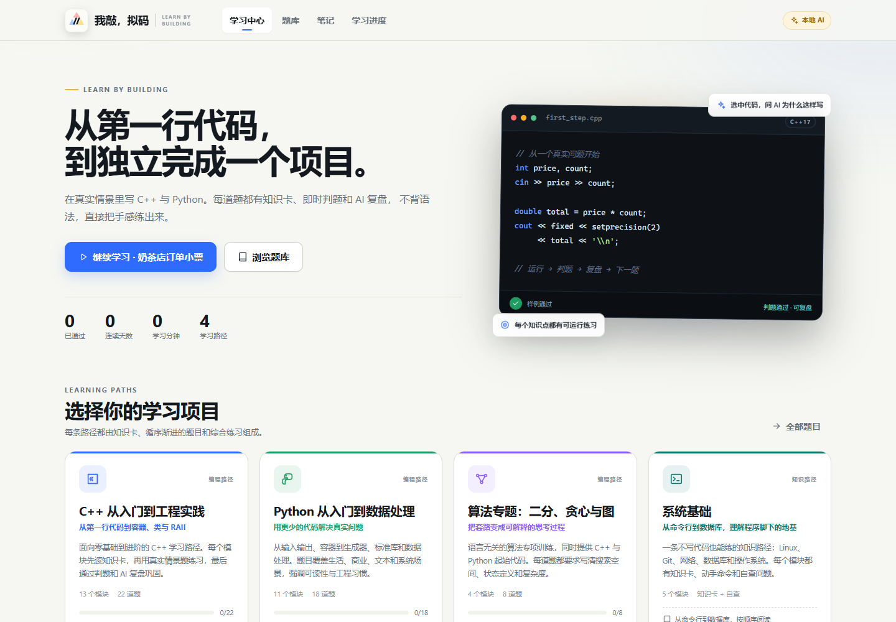
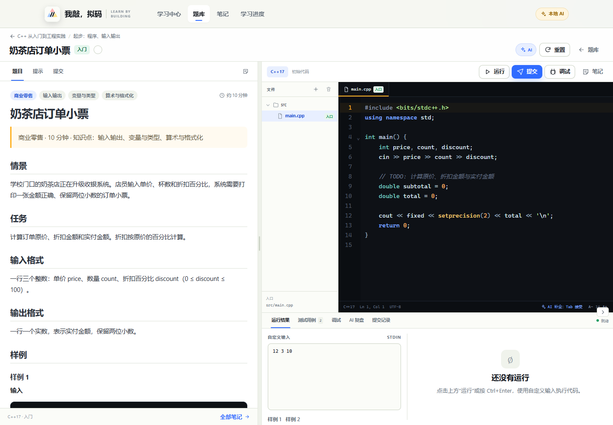
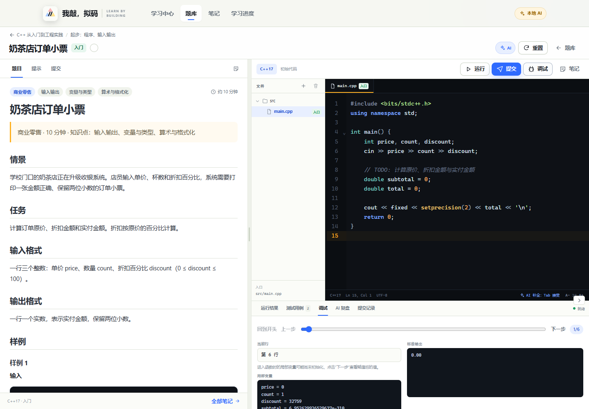
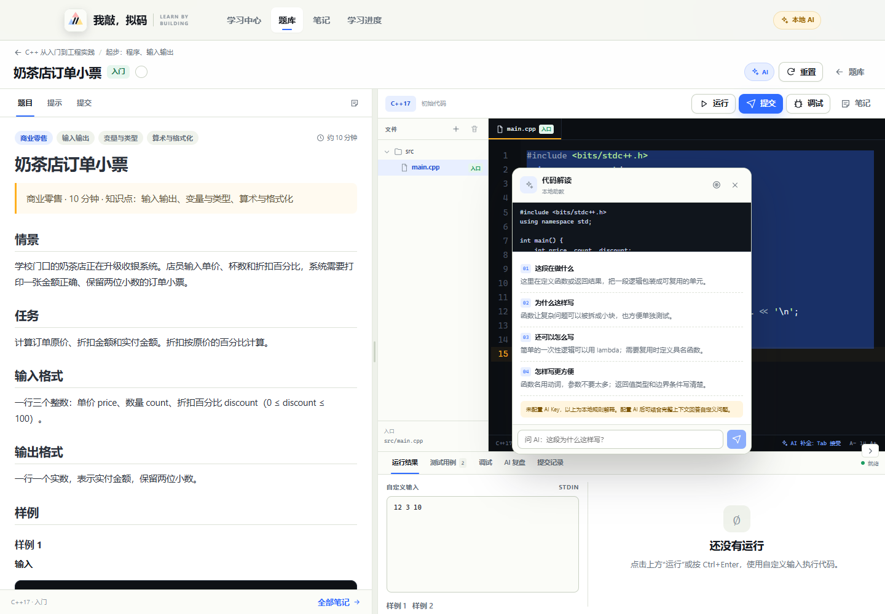
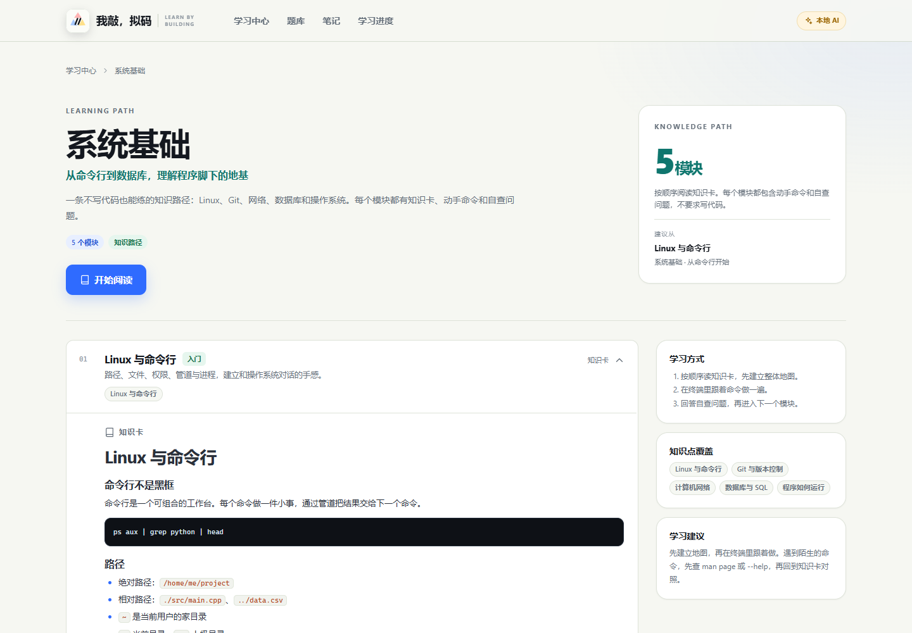
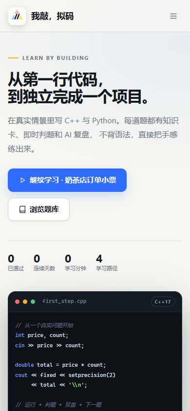

# 我敲，拟码 · CodeLab

一个可以在浏览器里“以练代学”的 C++ / Python 编程学习网站。桌面端优先，容器最大宽度 1280px，移动端提供基础响应式。


项目包含：

- 主界面：学习项目卡片、继续学习、最近活动、学习闭环说明
- 学习路径：知识卡 → 分模块练习 → 综合题
- 题目工作台：左侧题面、右侧 CodeMirror 编辑器
- 分级文件树、多文件标签、入口文件标记
- 运行、提交、调试、笔记四个主按钮；C++ / Python 调试均可查看逐行轨迹
- 真实本地判题：样例 + 隐藏用例，AC / WA / TLE / RE / CE / OLE
- AI 补全：本地词条 + AI 候选，Tab 接受，Esc 关闭
- 选中文字解释：含义 / 为什么 / 还能怎么写 / 怎么写方便 + AI 追问
- 提交后 AI 复盘：优点、问题、下一步建议、复杂度、类似题
- 无 AI Key 时自动降级为本地补全、本地解释和规则复盘
- 关于我们、联系服务（邮箱）、赞助我们（二维码）
- 站点不加载 Google Fonts，不请求国外 CDN

## 界面预览













## 当前内容

| 路径 | 模块 | 题目 |
|---|---:|---:|
| C++ 从入门到工程实践 | 13 | 22 |
| Python 从入门到数据处理 | 11 | 18 |
| 算法专题：二分、贪心与图 | 4 | 8 |
| 系统基础（知识路径） | 5 | 0 |
| **合计** | **33** | **48** |

所有 48 道编程题都包含：题面、样例、隐藏用例、起始代码、官方题解、知识点标签、渐进提示和相似题推荐。系统基础路径由 5 个知识卡模块组成，每张卡包含动手命令和自查问题。

## 技术栈

- 前端：React 19 + TypeScript + Vite + React Router + TanStack Query
- 编辑器：CodeMirror 6（C++ / Python 语法高亮、自动补全、Tab 缩进）
- 后端：Node.js + Fastify + Zod
- 数据库：Node 内置 `node:sqlite`（无需 native 编译）
- 测试：Vitest + Playwright Core
- 包管理：pnpm workspace

## 环境要求

- Node.js **22.5+**（必须包含 `node:sqlite`，推荐 Node 24）
- pnpm 10+
- Python 3.10+
- C++ 编译器：推荐 GCC 13+ / Clang 15+，默认标准为 C++17
- GDB 13+（可选，用于 C++ 逐行调试）
- 浏览器：Edge / Chrome / Firefox / Safari 近期版本

> 当前项目在 `tools/msys64/mingw64` 放置了便携 MSYS2 MinGW-w64 **GCC 16.2.0** 和 **GDB 18.1**，`.env` 已指向它们。该目录本地安装、不提交到 git；新环境可通过 MSYS2 安装后设置 `CXX` / `GDB`。

## 快速开始

```bash
pnpm install
cp .env.example .env        # Windows: Copy-Item .env.example .env
pnpm dev
```

开发地址：

- 前端：http://127.0.0.1:5173
- API：http://127.0.0.1:3001

生产构建与启动：

```bash
pnpm build
pnpm start
```

生产地址：http://127.0.0.1:3001

> `pnpm dev` 会同时启动 Fastify（3001）和 Vite（5173），Vite 将 `/api` 代理到后端。
> `pnpm start` 由 Fastify 同时提供 API 和 `apps/web/dist` 静态文件。

## 常用命令

| 命令 | 作用 |
|---|---|
| `pnpm dev` | 同时启动前后端开发服务 |
| `pnpm build` | 构建前端生产资源 |
| `pnpm start` | 启动生产后端（需先 build） |
| `pnpm typecheck` | 全 workspace TypeScript 检查 |
| `pnpm test` | Vitest 单元与接口测试 |
| `pnpm test:e2e` | 用本机 Edge/Chrome 做 UI 冒烟验证并截图 |
| `pnpm content:validate` | 校验题库 schema、ID、知识点、顺序 |
| `pnpm content:verify` | 用真实编译器/解释器跑所有官方题解 |
| `pnpm seed:content` | 从 `scripts/seed` 重新生成初始题库 |
| `pnpm qr:generate` | 生成赞助页示例二维码（可指定 `SPONSOR_QR_TEXT`） |
| `pnpm check` | typecheck + 内容校验 + 测试 |

`test:e2e` 默认查找 Edge/Chrome。也可以指定：

```bash
# Windows PowerShell
$env:BROWSER_PATH='C:\Program Files\Google\Chrome\Application\chrome.exe'; pnpm test:e2e
```

## 目录结构

```text
web_test/
├─ apps/
│  ├─ web/                         # React 前端
│  │  └─ src/
│  │     ├─ app/                   # 路由、404
│  │     ├─ components/            # 壳层、导航、按钮、Markdown
│  │     ├─ editor/                # CodeMirror、主题、补全
│  │     ├─ features/
│  │     │  ├─ home/               # 主界面
│  │     │  ├─ tracks/             # 学习路径
│  │     │  ├─ problems/           # 题库
│  │     │  ├─ workspace/          # 题目工作台、文件树、控制台、笔记
│  │     │  ├─ notes/              # 笔记页
│  │     │  ├─ progress/           # 学习进度
│  │     │  └─ site/               # 关于 / 联系 / 赞助
│  │     ├─ lib/                   # API、站点上下文、格式化
│  │     └─ styles/                # tokens / base / pages / workspace
│  └─ server/
│     └─ src/
│        ├─ app.ts                 # Fastify 应用与路由
│        ├─ config.ts              # 环境变量与工具链探测
│        ├─ content/               # 题库加载、公开视图、推荐
│        ├─ judge/                 # 判题、子进程运行器、答案比对
│        ├─ ai/                    # OpenAI 兼容适配、提示词、本地降级
│        ├─ db/                    # node:sqlite 迁移与数据访问
│        └─ index.ts
├─ packages/shared/                # 前后端共享类型与 Zod schema
├─ content/
│  ├─ registry.json                # 学习路径注册表
│  ├─ taxonomy.json                # 知识点树
│  ├─ tracks/
│  │  ├─ cpp/                      # track.json + modules + problems
│  │  ├─ python/
│  │  ├─ algorithms/
│  │  └─ systems/                  # 知识卡路径（无判题）
│  └─ site/                        # about/contact/sponsor 内容与配置
├─ scripts/
│  ├─ seed/                        # 初始化题库生成器
│  ├─ validate-content.ts
│  ├─ verify-solutions.ts
│  └─ verify-ui.mjs
├─ tests/
│  ├─ unit/
│  └─ integration/
├─ docs/
│  ├─ architecture.md
│  ├─ content-authoring.md
│  ├─ judge-security.md
│  ├─ deployment.md
│  └─ acceptance-checklist.md
├─ data/                           # SQLite 数据库（gitignore）
├─ tools/msys64/                   # 本地便携 GCC 16.2 + GDB 18.1（gitignore）
├─ .env.example
├─ package.json
├─ pnpm-workspace.yaml
└─ README.md
```

## AI 配置

AI 功能是可选的。未配置 Key 时站点仍可完整使用：本地补全、本地代码解释、基于判题结果的复盘、基于知识点的相似题推荐。

在 `.env` 中配置任意 OpenAI 兼容接口：

```env
AI_ENABLED=true
AI_BASE_URL=https://api.deepseek.com/v1
AI_API_KEY=your-key
AI_MODEL=deepseek-chat
AI_TIMEOUT_MS=20000
```

也可以接本地 Ollama：

```env
AI_BASE_URL=http://127.0.0.1:11434/v1
AI_MODEL=qwen2.5-coder:7b
```

安全约束：

- Key 只在服务端读取，不会发送到浏览器
- AI 请求由服务端发起
- AI 结果使用 Zod 校验，失败自动回退本地逻辑
- **AI 不能改变判题结果**；通过与否只由真实测试决定

## 内容扩展

新增题目：

1. 在 `content/tracks/<track>/problems/` 下创建题目目录
2. 写 `meta.json`、`statement.md`、`starters/<lang>/`、`solutions/<lang>/`、`solution.md`
3. 运行 `pnpm content:validate`
4. 运行 `pnpm content:verify <problem-id>` 验证官方题解
5. 重启开发服务（或等待热更新）后即可访问

新增语言 / 系统知识体系：

- 新语言：增加 `content/tracks/<lang>/`，在 `apps/server/src/judge/runner.ts` 中增加语言执行分支，并在前端注册对应 CodeMirror 语言扩展。
- 系统知识：`track.kind` 支持 `coding` / `knowledge` / `project`，知识卡与练习可以由同一套内容系统承载。
- 详细规范见 [docs/content-authoring.md](docs/content-authoring.md)。

### 联系与赞助

- 联系页只显示邮箱，邮箱在 `content/site/site.json` 的 `email` 字段修改。
- 赞助页只显示二维码，不设置价格档位。
- 替换赞助二维码：直接覆盖 `apps/web/public/assets/sponsor-qr.svg`，或运行：

```bash
# Windows PowerShell
$env:SPONSOR_QR_TEXT='https://你的收款页面或收款码内容'; pnpm qr:generate
```

重新构建并重启后生效。

## 判题说明

- 支持 C++17 与 Python 3
- 样例公开，隐藏用例只在服务端读取，不进入前端 bundle
- 判题结果：`AC / WA / TLE / RE / CE / OLE / SE`
- C++ 编译结果带缓存，避免同一份代码重复编译
- 当前运行器是本机子进程模式，适合个人学习 / 局域网演示

> **不要直接把本机判题服务暴露到公网。** 公网部署必须使用容器 / nsjail / Firecracker 等隔离执行器。详见 [docs/judge-security.md](docs/judge-security.md)。

## 设计说明

- 容器最大宽度 1280px
- 桌面端工作台使用可拖动分栏
- 移动端提供“题目 / 代码 / 运行”三视图
- 视觉参考 LeetCode 的信息密度、洛谷的题面结构、Codeforces 的状态反馈，但使用独立的“纸白 + 墨蓝 + 琥珀”设计语言
- 字体使用系统中文字体栈与系统等宽字体，不加载 Google Fonts
- 所有依赖在构建时打包，不请求外部 CDN
- CSP：`default-src 'self'`，AI 请求在服务端完成

## 已知限制

- 首版使用匿名浏览器档案（cookie + SQLite），没有注册登录；换浏览器会得到新的学习档案，可导出 JSON。
- C++ 调试通过 GDB 采集逐行源码位置和局部变量；暂不支持自定义断点和完整调用栈。Python 提供逐行执行轨迹。
- Windows 下首次运行刚编译的 C++ 程序可能被系统 Defender 扫描，耗时较长；运行器设置了更宽松的 Windows 墙钟上限并带编译缓存。
- 本机曾出现 Windows 应用控制策略拦截新编译 C++ 二进制（`spawn UNKNOWN`）的情况；本次已通过重试完成 56/56 题解验证。若你的环境复现，请按 [docs/judge-security.md](docs/judge-security.md) 排查，或改用 Linux / 容器判题。
- 题目数量为 48 道，覆盖入门到进阶主线，并新增 5 个系统基础知识模块；后续可通过内容系统继续扩充。
- 赞助页与联系方式当前为占位内容，正式信息填入 `content/site/` 即可。

## 验收

本次交付自动验证结果：

- `content:validate`：4 条路径 / 33 个模块 / 48 道编程题通过
- `content:verify`：56/56 个语言题解检查通过
- C++17 `<optional>` 与 GDB 逐行调试实测通过
- `pnpm test`：13/13 通过
- Playwright UI 冒烟：首页、路径、题库、工作台、选中解释、提交、笔记、联系、赞助、移动端均无 JS 报错

逐项验收请查看 [docs/acceptance-checklist.md](docs/acceptance-checklist.md)。

## License

本项目为学习与演示用途。题目内容、站点文案和品牌信息可按你的实际项目替换。
